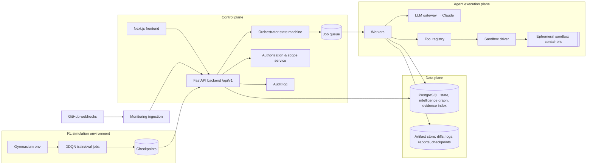
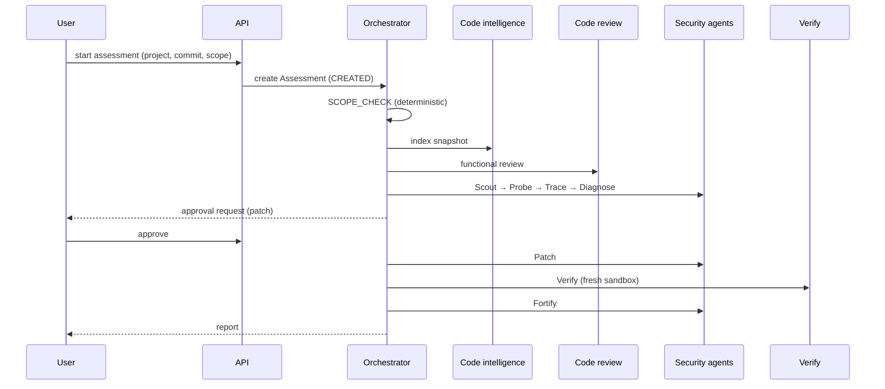

# 04 — System architecture

Status: **specified**. Decisions marked *proposed* are tracked as ADRs in
[decisions/](decisions/README.md).

## 1. Four planes

| Plane | Responsibility | Trust level |
|---|---|---|
| Control | Users, projects, scope, approvals, orchestration state, scheduling, audit | Trusted code; never runs untrusted code |
| Data | Durable state and artifacts | Trusted storage; repo content stored is untrusted *data* |
| Agent execution | Runs agent steps and tools; LLM calls; sandbox management | Trusted workers that drive **untrusted** sandboxes |
| RL simulation | Offline training/evaluation; produces checkpoints & recommendations | Isolated; no access to real systems |

## 2. Components and their homes

| Component | Directory | Spec |
|---|---|---|
| Frontend | `frontend/` | [14](14_FRONTEND_UX_DESIGN.md) |
| Backend API, auth, approvals, audit, orchestrator host | `backend/` | [13](13_BACKEND_API_DESIGN.md), [08](08_AGENT_ORCHESTRATION.md) |
| Intelligence layer (indexing, graph, expectations, retrieval) | `code-intelligence/` | [05](05_CODE_INTELLIGENCE_ENGINE.md), [11](11_SHARED_CONTEXT_AND_MEMORY.md) |
| Functional review & repair | `code-review/` | [06](06_CODE_REVIEW_AND_REPAIR.md) |
| Seven agents, tool registry, sandbox driver, workflow definitions | `security-agents/` | [07](07_SEVEN_AGENT_CYBERTEAM.md), [agents/](agents/AGENT_CONTRACT.md) |
| RL env, training, evaluation | `rl-defense/` | [09](09_RL_DEFENSE_SYSTEM.md), [17](17_RL_EVALUATION_PROTOCOL.md) |
| Event ingestion, correlation, triggers | `monitoring/` | [10](10_CONTINUOUS_MONITORING.md) |
| Contracts | `shared/` | [12](12_DATA_MODELS_AND_CONTRACTS.md) |

## 3. Process topology (MVP)

All Python subsystems are separate packages in one monorepo
([ADR-0001](decisions/0001-monorepo-layout.md)) but run as **two process types**:

1. `api` — FastAPI app (control plane). Imports `backend`, `shared`,
   `monitoring` (webhook handlers), and read-only query functions of
   `code-intelligence`.
2. `worker` — pulls jobs from the queue and runs: indexing, review, agent steps,
   verification, RL eval jobs. Imports `code-intelligence`, `code-review`,
   `security-agents`, `rl-defense`, `shared`.

Plus: `frontend` (Next.js), PostgreSQL, and short-lived sandbox containers
started by workers through the Docker API. Topology:
[architecture/deployment-topology](architecture/deployment-topology.md).

## 4. Communication rules

- Frontend ↔ backend: HTTPS JSON, `/api/v1`, types generated from `shared/`.
  Live progress via Server-Sent Events (`/api/v1/assessments/{id}/events`).
- Backend ↔ workers: job queue rows in PostgreSQL (*proposed*,
  [ADR-0005](decisions/0005-postgres-primary-store-and-queue.md)). Jobs carry IDs,
  not payload blobs.
- Subsystem ↔ subsystem: only via `shared/` contracts and public package APIs
  (`<pkg>/api.py`); never import another package's internals.
- Workers ↔ sandboxes: Docker API; files in via a mounted read-only workspace
  copy, results out via a writable `/out` volume collected after exit.
- Workers ↔ LLM: only through the LLM gateway (`backend`-owned module used by
  workers), which enforces budget, logs usage, redacts secrets, and validates
  structured output.

## 5. The assessment lifecycle (summary)

Full state machine: [08](08_AGENT_ORCHESTRATION.md) and
[architecture/assessment-lifecycle](architecture/assessment-lifecycle.md).

## 6. Cross-cutting concerns

| Concern | Where specified |
|---|---|
| Authorization, sandboxing, prompt injection | [15](15_SECURITY_BOUNDARIES.md), [architecture/sandbox-and-authorization](architecture/sandbox-and-authorization.md) |
| Shared context & freshness | [11](11_SHARED_CONTEXT_AND_MEMORY.md) |
| Logging, tracing, LLM cost | [19](19_OBSERVABILITY_AND_COST_CONTROL.md) |
| Data storage & retention | [architecture/data-flow-and-storage](architecture/data-flow-and-storage.md) |
| Deployment | [18](18_INFRASTRUCTURE_AND_DEPLOYMENT.md) |

## 7. Key architectural decisions (all proposed until ratified)

| ADR | Decision |
|---|---|
| [0001](decisions/0001-monorepo-layout.md) | Monorepo with one package per subsystem |
| [0002](decisions/0002-python-fastapi-backend.md) | Python 3.12 + FastAPI + Pydantic v2 backend |
| [0003](decisions/0003-deterministic-orchestrator.md) | Orchestrator is a deterministic state machine, not an LLM |
| [0004](decisions/0004-contract-first-shared-models.md) | Pydantic is the source of truth → JSON Schema → TS |
| [0005](decisions/0005-postgres-primary-store-and-queue.md) | PostgreSQL for state, graph, and job queue |
| [0006](decisions/0006-docker-sandbox-no-network-default.md) | Docker sandboxes, no network by default |
| [0007](decisions/0007-claude-llm-gateway.md) | Claude via a single LLM gateway; model id configurable |
| [0008](decisions/0008-offline-double-dqn.md) | Offline Double DQN in Gymnasium; recommendations only |
| [0009](decisions/0009-github-app-integration.md) | GitHub App for repo access and webhooks |
| [0010](decisions/0010-no-vector-db-for-mvp.md) | No vector DB for MVP; graph + lexical retrieval |

## 8. What is deliberately not in the architecture yet

Multi-tenancy isolation beyond row-level `org_id` scoping, horizontal worker
autoscaling, gVisor/Firecracker sandboxes, a separate graph database, streaming
event bus (Kafka etc.). Each is a backlog item with a trigger condition in
[26](26_RISKS_AND_TRADEOFFS.md).
