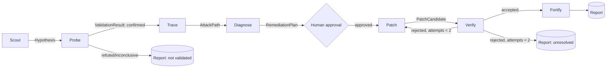

# 07 — The seven-agent cybersecurity team

Status: **specified**. Directory: `security-agents/`. Per-agent contracts:
[agents/](agents/AGENT_CONTRACT.md). Orchestration: [08](08_AGENT_ORCHESTRATION.md).

> This document describes responsibilities, contracts, permissions and controls.
> It intentionally contains no exploit techniques or payloads. Probe's checks
> come from a curated, reviewed library of non-destructive check templates
> ([agents/RED_PROBE](agents/RED_PROBE.md)), not from free-form model generation.

## Why seven narrow agents instead of one

- **Least privilege per step.** Scout can read code but never execute; Probe can
  execute only in a sandbox; Patch can write only in a worktree; Verify can only
  read the patch. One agent with all those powers is one prompt injection away
  from all of them.
- **Independent verification.** The agent that writes a fix must not be the one
  that judges it.
- **Typed, testable handoffs.** Each boundary is a schema we can validate, log,
  replay and unit-test.

They are *not* seven personas in one prompt, and they do not chat with each
other. The deterministic orchestrator passes typed artifacts between them.

## The team

| # | Agent | Team | Question it answers | Primary output |
|---|---|---|---|---|
| 1 | **Scout** | Red | Where could this be weak, and why do we think so? | `Hypothesis[]` |
| 2 | **Probe** | Red | Is this hypothesis real in the authorized sandbox? | `ValidationResult` |
| 3 | **Trace** | Red | If real, what could an attacker reach, and how bad is it? | `AttackPath` |
| 4 | **Diagnose** | Blue | What is the root cause relative to intended behavior? | `RootCause`, `RemediationPlan` |
| 5 | **Patch** | Blue | What minimal change fixes the root cause? | `PatchCandidate` |
| 6 | **Fortify** | Blue | What prevents this class of issue from recurring? | `HardeningRecommendation[]`, regression tests |
| 7 | **Verify** | Independent | Does the patch fix it without breaking intended behavior? | `VerificationResult` |

## Capability matrix

| Agent | Read context pack | Static tools | Execute in sandbox | Network | Write files | LLM |
|---|---|---|---|---|---|---|
| Scout | ✅ | ✅ (read-only analyzers) | ❌ | ❌ | ❌ | ✅ |
| Probe | ✅ (hypothesis-scoped) | ❌ | ✅ target sandbox | target-only, scope-checked | test harness in `/out` only | ✅ (to select/parameterize templates) |
| Trace | ✅ | ✅ graph queries | ❌ | ❌ | ❌ | ✅ |
| Diagnose | ✅ + Probe evidence | ✅ graph queries | ❌ | ❌ | ❌ | ✅ |
| Patch | ✅ | ✅ | ✅ worktree sandbox (tests only) | ❌ | worktree only | ✅ |
| Fortify | ✅ | ✅ | ❌ | ❌ | ❌ (suggestions as artifacts) | ✅ |
| Verify | patch diff + original evidence only | ✅ | ✅ fresh sandbox | target-only, scope-checked | ❌ | ✅ (summarize only; verdict is rule-based) |

Enforcement lives in the tool registry and sandbox driver, not in prompts
([agents/TOOL_REGISTRY](agents/TOOL_REGISTRY.md), [15](15_SECURITY_BOUNDARIES.md)).

## Handoff chain

Handoff payload and rules: [agents/AGENT_CONTRACT](agents/AGENT_CONTRACT.md) §Handoffs.

## Finding status lifecycle (security findings)

`hypothesis → validated | refuted | inconclusive → diagnosed → patch_proposed →
verified | patch_rejected → hardened → closed`. Only `validated` and later states
are shown as "findings" in the UI; `hypothesis` items appear in a separate,
clearly labeled list. Severity is assigned by Trace using a documented rubric
(CVSS-like base factors: reachability, privileges required, data sensitivity
from expectations) and is always labeled with its inputs.

## Relationship to the other pillars

- **Input from P1:** entry points, call graph and *behavioral expectations*.
  An authorization hypothesis is only meaningful relative to an expectation such
  as "customers can only read their own payments".
- **Output to P1:** validated findings and verified patches create regression
  tests that join the project's behavioral test set.
- **Output to P3:** verified findings and their affected symbols seed the
  monitoring impact map; attack paths inform the RL simulator's scenario
  templates (class-level only, never concrete exploit data).

## Model usage

All agents use the LLM gateway with model id from `ANTHROPIC_MODEL`
(default `claude-haiku-5-5` since #340, [ADR-0015](decisions/0015-haiku-default-model.md); the initial target was
`claude-opus-5-5`) or `AGENT_MODEL_OVERRIDES`. Structured outputs
are validated with Pydantic; invalid output = failed step with one retry
including the validation error. Each agent has its own token budget slice
([08](08_AGENT_ORCHESTRATION.md) §Budgets).
