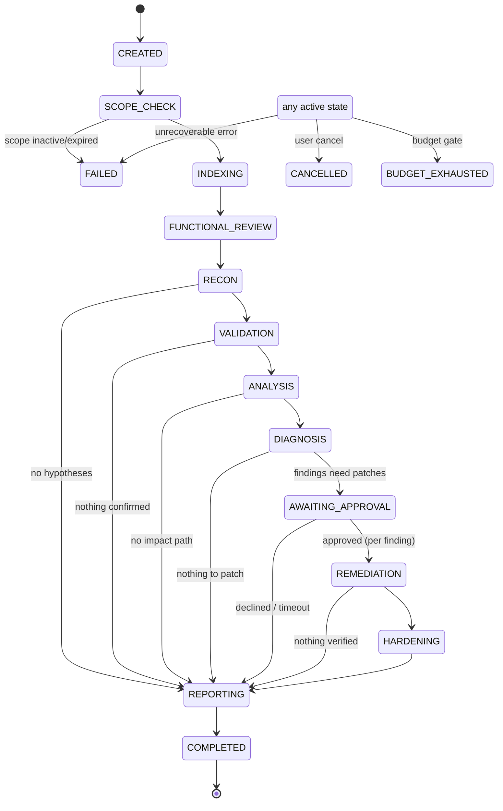
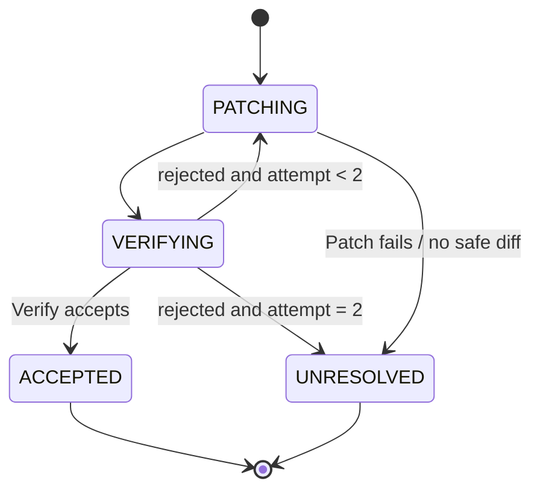

# 08 — Agent orchestration

Status: **specified**. Decision: [ADR-0003](decisions/0003-deterministic-orchestrator.md).
Home: workflow definitions in `security-agents/`, state persisted and hosted by
`backend/`.

## Principles

1. The orchestrator is a **deterministic state machine** written in Python.
   An LLM may *suggest* (e.g. ranking hypotheses) but never chooses the next
   state, grants a permission, or skips a gate.
2. Every transition is persisted before side effects start (write-ahead), so a
   crashed worker can resume or fail the step cleanly.
3. Every transition emits an `AuditEvent` and an SSE progress event.
4. Gates (scope, approval, budget) are checked in code at the transition, not
   inside agents.

## Assessment state machine

`REMEDIATION` runs a per-finding sub-machine:

Validation (`VALIDATION`) fans out per hypothesis with a concurrency limit
(default 3 sandboxes per assessment) and a cap on hypotheses validated per run
(default 10, ranked by Scout confidence × expectation criticality).

## Step execution contract

Each agent step is one job: `AgentStepJob(assessment_id, agent, input_ref, attempt)`.
The worker:

1. loads the typed input artifact by reference;
2. builds the context pack (code-intelligence retriever);
3. asks the tool registry for the agent's **tool allowlist** for this step
   (static per agent + scope-derived constraints);
4. runs the agent loop (LLM ↔ tools) under step budget and wall-clock timeout;
5. validates the output against the agent's output schema;
6. stores output artifact + evidence, writes `AgentRun` record;
7. returns control; the orchestrator computes the next transition.

## Gates

| Gate | Where | Rule |
|---|---|---|
| Scope | `SCOPE_CHECK` and before every network-capable tool call | AuthorizedScope `active`, unexpired, target in scope, approver ≠ requester (when org has > 1 member) |
| Approval: remediation | `AWAITING_APPROVAL` | Human approves per finding; default timeout 24h → declined |
| Approval: PR creation | Outside the assessment, from UI | Human action; platform opens PR on a branch, never merges |
| Budget | Before every LLM call and step | Assessment and per-agent token/USD caps |
| Kill switch | Global | `ASSESSMENTS_PAUSED` flag halts new steps and stops running sandboxes |

## Budgets (defaults, configurable per project)

| Agent | Share of assessment token budget | Wall clock / step |
|---|---|---|
| Scout | 20% | 5 min |
| Probe | 20% (across hypotheses) | 3 min per hypothesis |
| Trace | 10% | 3 min |
| Diagnose | 10% | 3 min |
| Patch | 20% | 8 min |
| Verify | 10% | 8 min |
| Fortify | 10% | 3 min |

Unspent share returns to the pool. Functional review has its own budget line.

## Failure and retry policy

| Failure | Policy |
|---|---|
| Schema-invalid LLM output | Retry once with validation error; then step `FAILED` |
| Tool error (sandbox start, timeout) | Retry once with backoff; then step `FAILED` |
| Scope denial | No retry; assessment → `FAILED` with `SCOPE_DENIED` |
| Budget exhausted | No retry; → `BUDGET_EXHAUSTED`, partial report produced |
| Worker crash | Lease expiry (default 2× step timeout) requeues the job with same attempt count |

A failed step for one hypothesis does not fail the assessment; it marks that
hypothesis `inconclusive`.

## Idempotency

Jobs carry `(assessment_id, step_key, attempt)`; outputs are written with that key
and re-execution of a completed key is a no-op. Sandbox names include the key so
orphaned containers can be reaped.

## Replay

Every LLM request/response, tool call and result is recorded (redacted) so an
assessment can be replayed with a fake model for debugging and tests
([16](16_TESTING_AND_VERIFICATION.md) §recorded responses).
