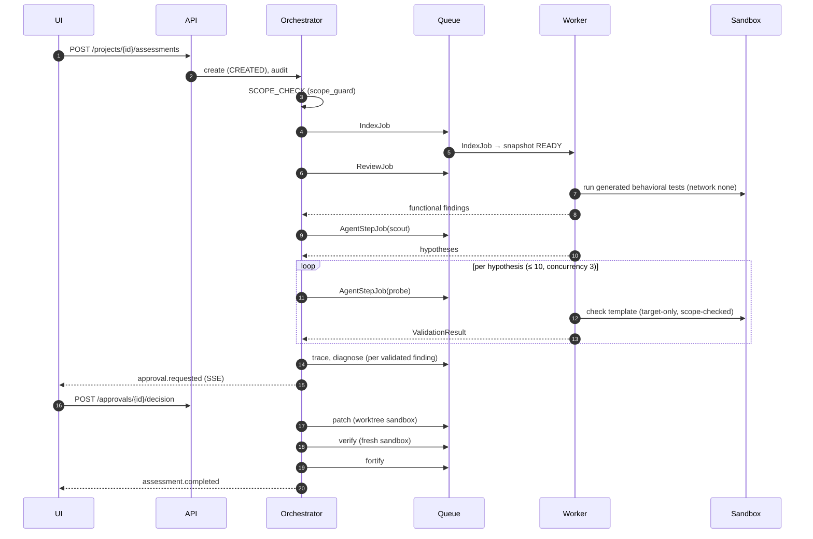

# Assessment lifecycle

Status: **specified**. State machine: [08](../08_AGENT_ORCHESTRATION.md).

## Sequence

## Artifacts per step

| Step | DB records | Artifacts |
|---|---|---|
| Index | Snapshot, Symbol, CallEdge, EntryPoint, Expectation | — |
| Review | Finding(functional), GeneratedTest, TestRun | test files, run logs |
| Scout | AgentRun, Hypothesis, Finding(hypothesis) | transcript (redacted) |
| Probe | AgentRun, ValidationResult | sandbox log, check output |
| Trace | AttackPath, SeverityAssessment | — |
| Diagnose | RootCause, RemediationPlan | — |
| Patch | PatchCandidate | diff, local test logs |
| Verify | VerificationResult | sandbox logs per check |
| Fortify | HardeningRecommendation, RegressionTest | proposed tests |
| Report | Assessment summary | report JSON |

## Concurrency & resumption

Orchestrator transitions run in a DB transaction with `SELECT … FOR UPDATE` on
the assessment row. Jobs are leased; expired leases requeue. On restart, the
orchestrator scans non-terminal assessments and re-emits missing jobs by
`step_key`.
