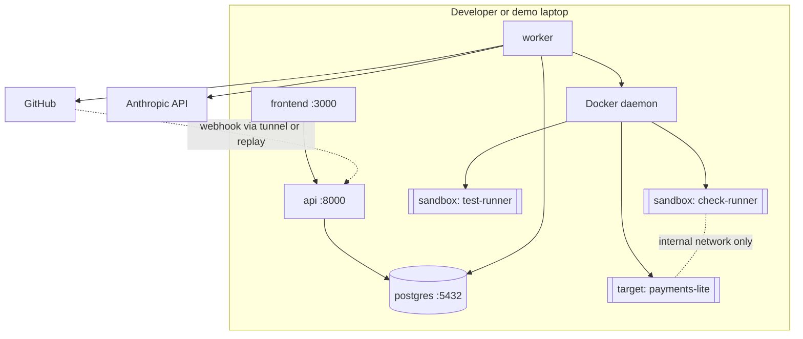

# Deployment topology

Status: **specified; nothing provisioned.** Spec: [18](../18_INFRASTRUCTURE_AND_DEPLOYMENT.md).

## Local / demo (MVP)

## Hosted option (only if approved, post-MVP)

| Piece | Host | Note |
|---|---|---|
| Frontend | Vercel (free tier) | Static + SSR |
| API | Railway (free/trial) | No Docker socket needed |
| Worker + sandboxes | Dedicated VM with Docker/gVisor | Paid; requires approval and ADR |
| Postgres | Managed free tier | Backups needed |

The API can be hosted without the worker; a hosted deployment without a sandbox
host can show results but not run assessments.
