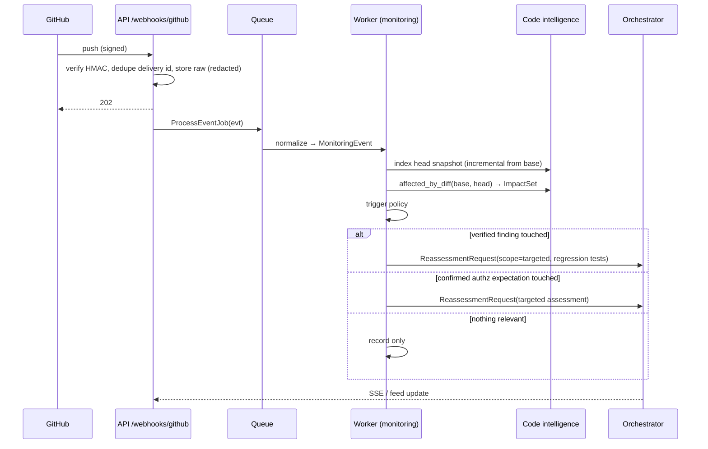

# Event lifecycle

Status: **specified**. Product spec: [10](../10_CONTINUOUS_MONITORING.md).

## Push event → re-assessment

## Event states

`received → normalized → correlated → decided → (requested | recorded | blocked_no_scope | coalesced) → done`,
or `failed` with error code. Each state change is stored on the event row.

## Coalescing

Events for the same repo within a 10-minute window merge into one
ReassessmentRequest using the newest head SHA and the union of impacts.

## Runtime events (S)

Collector inside the target sandbox writes JSON lines → worker tails `/out` →
computes per-route signals → `MonitoringEvent(type=log_anomaly)` if a threshold
is crossed → same decision step. Signals can also be exported as observation
sequences for RL offline evaluation.
