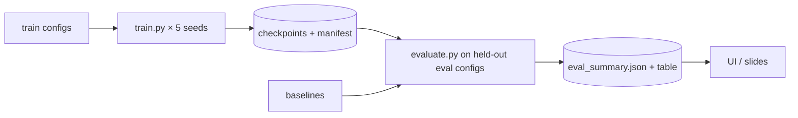

# RL training and inference

Status: **specified**. Spec: [09](../09_RL_DEFENSE_SYSTEM.md); protocol:
[17](../17_RL_EVALUATION_PROTOCOL.md).

## Package layout (planned, `rl-defense/rl_defense/`)

| Module | Responsibility |
|---|---|
| `envs/defense_sim.py` | `DefenseSimEnv` (Gymnasium API, registered as `DefenseSimEnv-v0`) |
| `envs/adversary.py` | Stage-transition model |
| `envs/config.py` | Pydantic scenario config; hashing |
| `agents/ddqn.py` | Q-network, target net, update rule |
| `agents/replay.py` | Replay buffer |
| `baselines/` | `random`, `noop`, `threshold_rules` |
| `train.py` | CLI: `python -m rl_defense.train --config … --seed …` |
| `evaluate.py` | CLI: protocol runner → `eval_summary.json` |
| `inference.py` | Load checkpoint → `recommend(observation) -> DefenseRecommendation` |
| `observations.py` | Map platform facts (criticality, finding severity, signals) → observation vector |

## Training flow

Runs on CPU; outputs to `RL_RUNS_DIR` (git-ignored).

## Inference flow (recommendations only)

1. Backend requests recommendation for a project (on demand or after a
   monitoring event).
2. `observations.py` builds the observation from the project's demo topology
   mapping + current facts.
3. `inference.py` loads the pinned checkpoint (by `RLCheckpoint.id`), returns
   argmax action and Q-margin.
4. Backend stores `DefenseRecommendation` with fixed caveat text. No code path
   exists from a recommendation to any action.

## Reproducibility

Seeds for Python, NumPy, PyTorch and env; `torch.use_deterministic_algorithms(True)`
on CPU; config hash and git SHA in every manifest.
