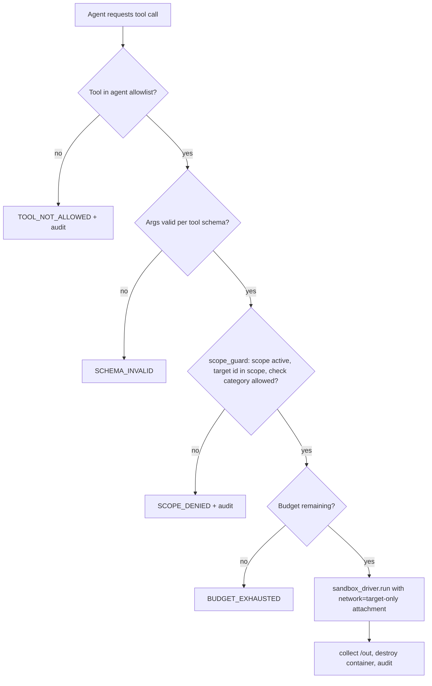

# Sandbox and authorization

Status: **specified**. Rules: [15](../15_SECURITY_BOUNDARIES.md). This doc describes
the components that enforce them. Contains no attack techniques.

## Components

| Component | Package | Role |
|---|---|---|
| `scope_guard` | `security-agents` (pure functions) | Decide whether action A on target T is allowed under scope S |
| `tool_registry` | `security-agents` | Map agent+step → allowed tools; validate arguments; call `scope_guard` |
| `sandbox_driver` | `security-agents` | Create/run/collect/destroy containers with policy-derived config |
| `target_builder` | `security-agents` | Build and start the scoped target container from `build_recipe_ref` |
| `approvals` | `backend` | Human decisions; consulted by orchestrator gates |
| `audit` | `backend` | Hash-chained log of every decision |

## Decision flow for a network-capable tool call



## `scope_guard` interface (planned)

```
check(scope: AuthorizedScope, request: ActionRequest, now: datetime) -> Decision
ActionRequest { action: run_check|attach_network|build_target, target_id, check_category?, agent }
Decision { allowed: bool, reason_code, scope_id, evaluated_at }
```
Pure, no I/O; the caller loads the scope. Exhaustively unit-tested.

## Sandbox profiles

| Profile | Used by | Network | Mounts | Notes |
|---|---|---|---|---|
| `test-runner` | review, Patch, Verify (functional) | none | workspace (ro copy), `/out` | Runs target's test suite |
| `check-runner` | Probe, Verify (re-check) | target-only | check harness (ro), `/out` | Runs one check template against target |
| `target` | target_builder | internal network only | none | The app under test, synthetic fixture data |

Common: non-root, cap-drop ALL, no-new-privileges, read-only rootfs, tmpfs
`/tmp`, CPU/mem/pids/time limits, labels `{assessment_id, step_key}` for reaping.

## Network modes

- `none`: `--network none`.
- `target-only`: a per-step internal Docker network (`internal: true`, no
  gateway) attaching exactly the check-runner and the target. Created by
  `sandbox_driver` only after `scope_guard` allows `attach_network`; destroyed
  with the step.

## Worktree isolation (Patch)

Patch writes in `.worktrees/<patch_id>` created from the snapshot SHA. The
worktree is copied into a `test-runner` sandbox for tests; Verify receives only
the diff artifact and applies it to a fresh checkout in its own sandbox.
