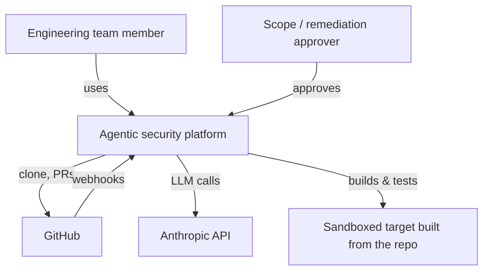

# System context

Status: **specified**.

## Level 1 — context

External systems: GitHub (code, events, PRs), Anthropic API (models). The
sandboxed target is *inside* our boundary — MVP never tests anything outside it.

## Level 2 — containers

| Container | Tech | Responsibility | Talks to |
|---|---|---|---|
| Web app | Next.js | UI | API (HTTPS, SSE) |
| API | FastAPI | Auth, projects, scope, approvals, orchestrator, webhooks, audit | Postgres, artifact store, GitHub |
| Worker | Python | Indexing, review, agents, verification, RL eval | Postgres, artifact store, Docker, Anthropic, GitHub |
| PostgreSQL | 16 | State, intelligence facts, queue, audit | — |
| Artifact store | Local FS → S3-compatible | Diffs, logs, reports, checkpoints | — |
| Sandbox containers | Docker | Run untrusted code & checks | Only the scoped target container (if `target-only`) |

## Actors and permissions (MVP)

| Actor | Can |
|---|---|
| Owner | Everything in org incl. approve scopes, read audit |
| Member | Create projects, request scopes, start assessments, approve remediation (configurable) |
| Viewer | Read |
| System (orchestrator) | Transitions within gates |
| Runtime agent | Only allowlisted tools for its step |
