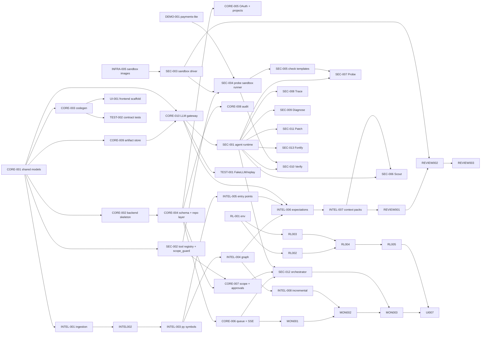

# Dependencies

Source of truth for task-level dependencies is the "Depends on" column in
[HACKATL_TASKS](HACKATL_TASKS.md); this page visualizes it. If they disagree, fix
this page.

## Task dependency graph (MVP)

## Critical path (longest chain to the demo)

CORE-001 → CORE-010 → INTEL-006 → INTEL-007 → SEC-006 / REVIEW-001 → … →
SEC-010 → TEST-005 → DEMO-002.

Parallel chains that must merge before TEST-005: sandbox (INFRA-005 → SEC-003 →
SEC-004 → SEC-005), backend (CORE-002 → CORE-004 → CORE-006/007 → SEC-012),
RL (RL-001 → RL-004), UI (UI-001 → UI-003 → UI-004 → UI-006).

## Starting points (no dependencies)

DOCS-002, DOCS-003, DOCS-004, INFRA-005, CORE-001, DEMO-001, RL-001 — plus
INFRA-002 and INFRA-003, whose only dependency (INFRA-001) is done.

## Unblocking strategy

Consumers develop against fixtures produced from the `shared/` models
([25](../25_INTEGRATION_STRATEGY.md)), so e.g. UI-004 can start with fixture
findings before SEC-* agents exist; its `DONE` still requires the real path.
