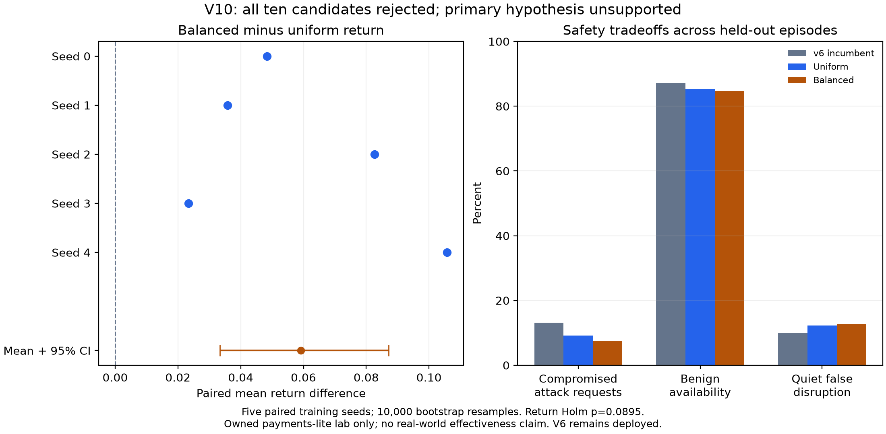

# V10 results and provenance

Completed both preregistered arms and all five seeds per arm without execution errors. The primary hypothesis is **unsupported** because every balanced candidate fails at least one unchanged promotion gate. No policy was registered, selected for deployment or promoted; the actual v6 registry is unchanged.

## Run and experimental scope

Frozen source `a98899db58e007167f9c25a5982baade1b5693ee`; tracked repository fingerprint `e8556ad88b303cf821e5ba661662aeb75583c208201d798073004bae6c42187b`. Started 2026-10-21T11:32:33.060195+00:00, ten jobs finished 2026-10-21T17:30:50.439306+00:00 (5h58m17s, before final diagnostics/verification). Five CPU workers; runtime versions and reference hashes are in [RUN.json](RUN.json). Source and preregistration were committed/pushed before launch. No source changes, retries or replacement seeds during execution.

Each arm used seeds0–4, 4,200 demonstration rows, 5,000 pretraining updates and150,000 online transitions/updates per seed. All ten selected checkpoints reload. Complete experiment data are retained even when an earlier snapshot is selected. Eleven policies ×three scenarios ×100 held-out episodes ×ten runs =33,000 episodes. Raw paired traces are retained. The only intervention is balanced sampling of observed demonstration action classes; agent replay stays uniform.

## Primary outcome and tradeoffs

- Balanced minus uniform, `reward`: +0.05918667; 95% bootstrap CI [+0.03334667, +0.08713333]; paired t p=0.017901, Holm p=0.0895048.
- Balanced minus uniform, `compromise_rate`: -0.01725361; 95% bootstrap CI [-0.03876362, -0.00187484]; paired t p=0.190467, Holm p=0.761869.
- Balanced minus uniform, `availability`: -0.00508327; 95% bootstrap CI [-0.01220905, -0.00022406]; paired t p=0.22077, Holm p=0.761869.
- Balanced minus uniform, `false_disruption`: +0.00584307; 95% bootstrap CI [+0.00023567, +0.01339194]; paired t p=0.19847, Holm p=0.761869.
- Balanced minus uniform, `no_attack_defense_duty`: +0.01256163; 95% bootstrap CI [-0.00154341, +0.02666667]; paired t p=0.192851, Holm p=0.761869.
- Balanced minus uniform, `actions_per_step`: +0.00446667; 95% bootstrap CI [+0.00268889, +0.00635556]; paired t p=0.0133006, Holm p=0.0798036.

Return improves in all five paired seeds. The preregistered return CI is positive, but the return t-test does not survive the six-metric Holm correction (p=0.0895). Compromise fraction decreases while availability decreases and quiet false disruption increases. These are tradeoffs, not sufficient evidence for deployment. Bootstrap intervals use10,000 resamples of five paired training-seed means (seed1); episode observations are not treated as independent training replicates.

## Uniform arm

Return gain vs actual v6: +0.23161481, 95% CI [+0.18369481, +0.26934815].

- `candidate` means: reward=-6.25260000; compromise_rate=0.09151254; availability=0.85287122; false_disruption=0.12209857; no_attack_defense_duty=0.31948553; actions_per_step=0.11688889.
- `deployed` means: reward=-6.48421481; compromise_rate=0.13174563; availability=0.87237809; false_disruption=0.09935472; no_attack_defense_duty=0.28703108; actions_per_step=0.69066667.
- `threshold_rules` means: reward=-6.18726667; compromise_rate=0.06637953; availability=0.84640160; false_disruption=0.12810250; no_attack_defense_duty=0.31961415; actions_per_step=0.12211111.
- `v8` means: reward=-6.19373333; compromise_rate=0.06979985; availability=0.84526132; false_disruption=0.13154400; no_attack_defense_duty=0.34512326; actions_per_step=0.12177778.
- `v9` means: reward=-6.18942667; compromise_rate=0.06939448; availability=0.84536534; false_disruption=0.13088563; no_attack_defense_duty=0.34353698; actions_per_step=0.12215556.

Per-scenario mean return (candidate / v6):

- holdout10_persistent: -0.67396000 / -0.96864444.
- holdout10_quiet: -3.30252000 / -3.70240000.
- holdout10_rotation: -14.78132000 / -14.78160000.

All seed gate failures and validation-selected snapshots:

- Seed0: reject; selected step135000, noop margin0.5; failed beats_static_rules.
- Seed1: reject; selected step135000, noop margin0.5; failed availability_floor, beats_static_rules, no_per_scenario_regression.
- Seed2: reject; selected step30000, noop margin0.3; failed paired_reward_gain_ci_low, beats_static_rules, no_per_scenario_regression.
- Seed3: reject; selected step135000, noop margin0.0; failed availability_floor, beats_static_rules, no_per_scenario_regression.
- Seed4: reject; selected step135000, noop margin0.5; failed paired_reward_gain_ci_low, beats_static_rules, no_per_scenario_regression.
## Balanced arm

Return gain vs actual v6: +0.29080148, 95% CI [+0.27056148, +0.31045481].

- `candidate` means: reward=-6.19341333; compromise_rate=0.07425893; availability=0.84778795; false_disruption=0.12794164; no_attack_defense_duty=0.33204716; actions_per_step=0.12135556.
- `deployed` means: reward=-6.48421481; compromise_rate=0.13174563; availability=0.87237809; false_disruption=0.09935472; no_attack_defense_duty=0.28703108; actions_per_step=0.69066667.
- `threshold_rules` means: reward=-6.18726667; compromise_rate=0.06637953; availability=0.84640160; false_disruption=0.12810250; no_attack_defense_duty=0.31961415; actions_per_step=0.12211111.
- `v8` means: reward=-6.19373333; compromise_rate=0.06979985; availability=0.84526132; false_disruption=0.13154400; no_attack_defense_duty=0.34512326; actions_per_step=0.12177778.
- `v9` means: reward=-6.18942667; compromise_rate=0.06939448; availability=0.84536534; false_disruption=0.13088563; no_attack_defense_duty=0.34353698; actions_per_step=0.12215556.

Per-scenario mean return (candidate / v6):

- holdout10_persistent: -0.35176000 / -0.96864444.
- holdout10_quiet: -3.33944000 / -3.70240000.
- holdout10_rotation: -14.88904000 / -14.78160000.

All seed gate failures and validation-selected snapshots:

- Seed0: reject; selected step90000, noop margin0.5; failed no_per_scenario_regression.
- Seed1: reject; selected step60000, noop margin0.0; failed availability_floor, no_per_scenario_regression.
- Seed2: reject; selected step75000, noop margin0.2; failed availability_floor, beats_static_rules, no_per_scenario_regression.
- Seed3: reject; selected step75000, noop margin0.0; failed availability_floor, beats_static_rules, no_per_scenario_regression.
- Seed4: reject; selected step60000, noop margin0.5; failed availability_floor, beats_static_rules, no_per_scenario_regression.

## Secondary checks and retained failure

All ten models pass both train-only platform diagnostic cases: quiet noop100%, flagged-principal block100%, mapping agreement100% over280 windows/model. These secondary train-window results do not replace held-out gates. Both cases and all seeds are in [secondary_checks.json](secondary_checks.json).

The worst candidate-minus-incumbent paired episode across both arms is uniform seed2, holdout10_persistent, evaluation seed43203: return−28.0 vs v6−0.4 (difference−27.6). Candidate takes noop on all30 windows and compromises84/84 attack requests; v6 compromises0/84 with20 control actions. Both have zero benign requests blocked. Both complete raw traces are in [failure_case.json](failure_case.json); this is one selected failure, not a pooled estimate.

## Verification and reproduction

Read-only verification executed successfully after the parent runner exited0: all123 originally indexed artifacts and all ten compressed seed evidence indices verify; all ten checkpoints reload and pin the frozen source and selected experience prefix. Stored rows contain exactly33,000 held-out episodes. Regenerating the two-arm summary from saved promotion reports reproduces the saved JSON exactly after JSON normalization. The source fingerprint and real registry digest also match launch metadata. No held-out policy was rerun for reporting.

Run from `rl-defense` with the documented workspace PYTHONPATH and RL Python runtime:

```sh
python results/live-retrain-v10/postprocess.py results/live-retrain-v10 --verify-only
```

The final [STUDY_EVIDENCE.json](STUDY_EVIDENCE.json) additionally pins this report and any scientific figure/rendering code. `postprocess.py --verify-only` streams saved evidence; omitting `--verify-only` repeats train-only diagnostics, not holdout evaluation. Do not relaunch the experiment over these outputs.

## Limits and next research

Owned, isolated in-process payments-lite lab only; not a canonical simulator benchmark or proof of real-world effectiveness. Five training seeds, one fixed incumbent, matched seed-specific v9 references and three held-out regimes limit generalization. Fixed-policy intervals collapse because identical deterministic references are repeated across training seeds; this does not imply zero real-world uncertainty.

Balanced sampling is an implemented experimental option with a positive return contrast in this experiment; it is not a deployable solution. All balanced seeds regress in at least one scenario; four fail the85% availability floor and three fail to beat static rules. A future experiment should address rotation and availability costs with a new preregistration and fresh holdout. This holdout is now exposed and must not become a selection set. No follow-up training is launched by this report.



Post-run regression validation: 12 tests passed in 23.20s (`test_v10_evidence.py`, `test_live_v10.py`, `test_live_v10_reporting.py`); Ruff lint/format and diff checks passed. These tests stream saved evidence and regenerate statistics without executing a held-out policy.
